# E-Sys MAX (EsysMax): E-Sys launcher for BMW coding, F series and G series

**E-Sys MAX** is a Windows E-Sys launcher and add-on for coding BMW F series and G series cars with BMW E-Sys
(and MINI and Toyota Supra built on them). An E-Sys Ultra alternative, made by KDR Coding.
**139,000+ coding settings in plain English, in 10 languages.**

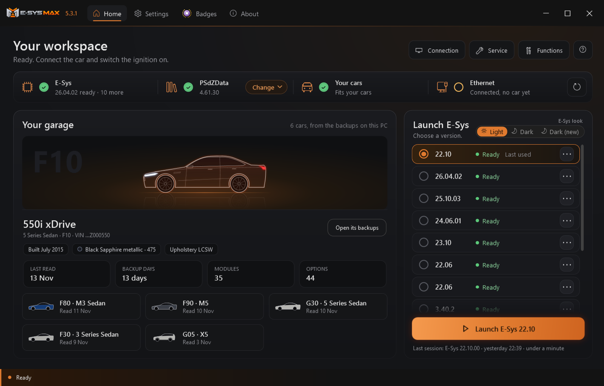

> **Like E-Sys MAX?** Tap the ⭐ **Star** button at the top of this page. It takes one second and helps other
> BMW owners find it.

## Get E-Sys MAX

- **[esysmax.com/buy](https://esysmax.com/buy)**: buy a licence, start a free trial with your card, or use an invite code.
  Your private download link comes right after (Windows 10 and 11).
- Licences are one-time payments with every feature: 1 month $39, 1 year $59 or **lifetime $99**
  (every update, priority support and setup help).
- Every update and what it changed: [esysmax.com/changelog](https://esysmax.com/changelog)

## What it does

- **139,000+ E-Sys coding settings named in English**: G series settings that E-Sys shows as a dot get their name,
  and 5,600+ option codes are named too
- **10 languages**: English, German, Spanish, Italian, Russian, Romanian, Turkish, Japanese, Chinese and Korean
- Starts any E-Sys version with the right Java, memory and PSdZData; works over an ENET cable or a BMW ICOM
- One-click coding changes (cheat sheets) and **what to code for a feature**: every module it needs
- Vehicle order (VO) helper, FDL coding help, full backups and a history of every coding change
- **Car recovery**: compare the car today with a full backup (vehicle order, coding, modules and faults)
- Fault scan of every module with 9,000+ codes explained, **service reset** and service functions
- Car report as a PDF: options, modules and coding of the car
- **Badges and levels**: real coding work earns badges and a rank, from bronze up to mythic

## Screenshots

### Start in 3 steps
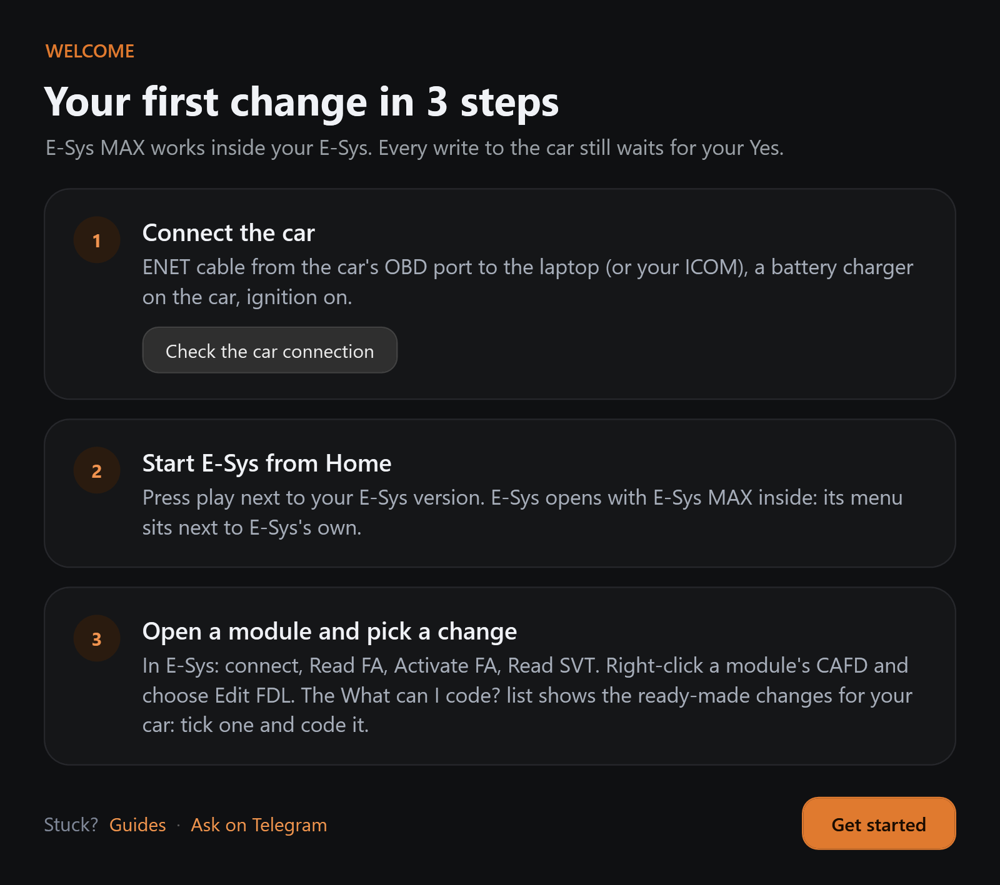

### Every setting with a name and a plain explanation
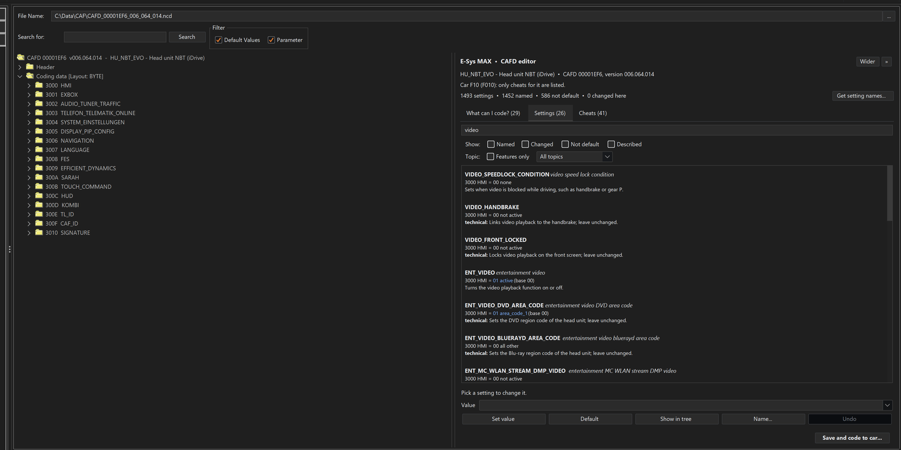

### What to code for a feature
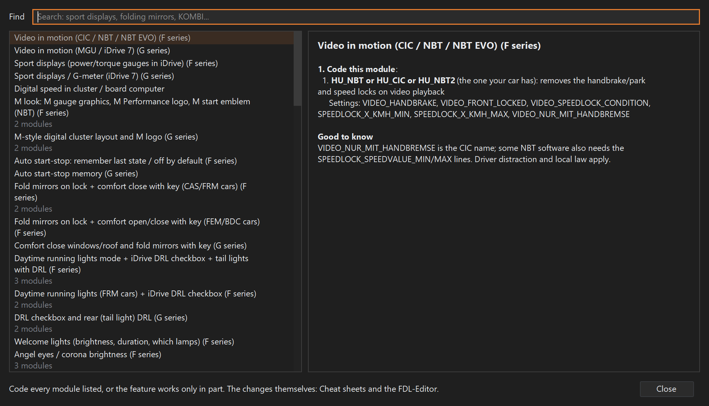

### Vehicle order (VO) helper
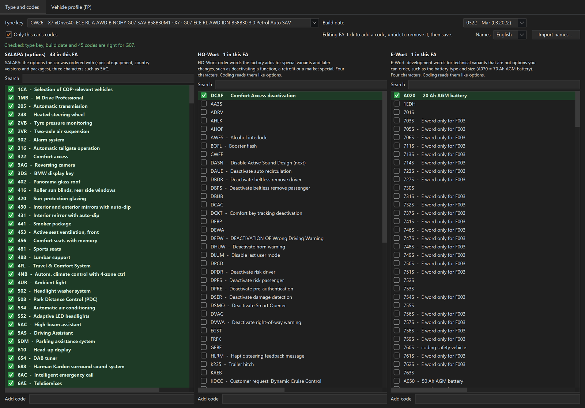

### Coding history: see what changed and put it back
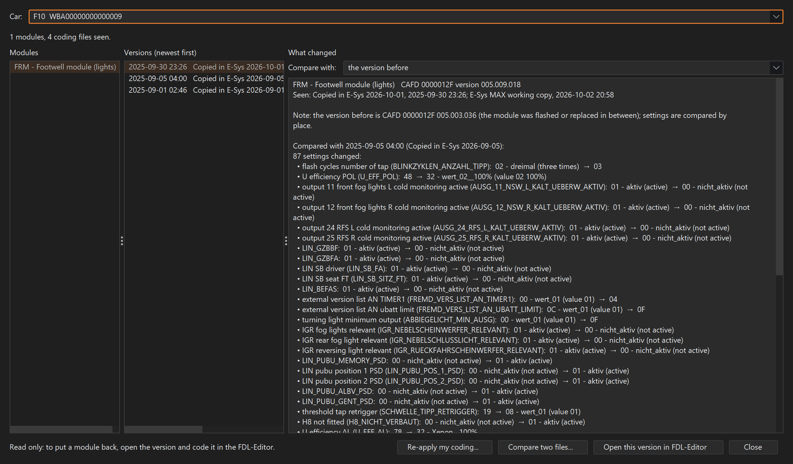

### Service reset
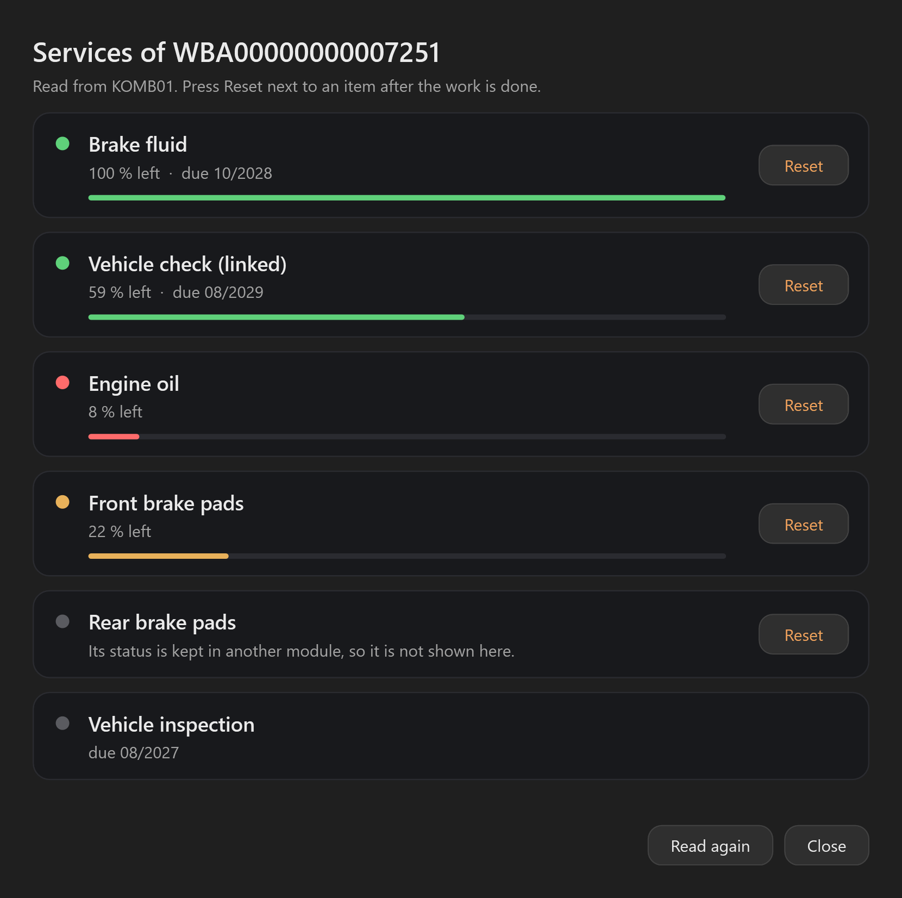

### Service functions
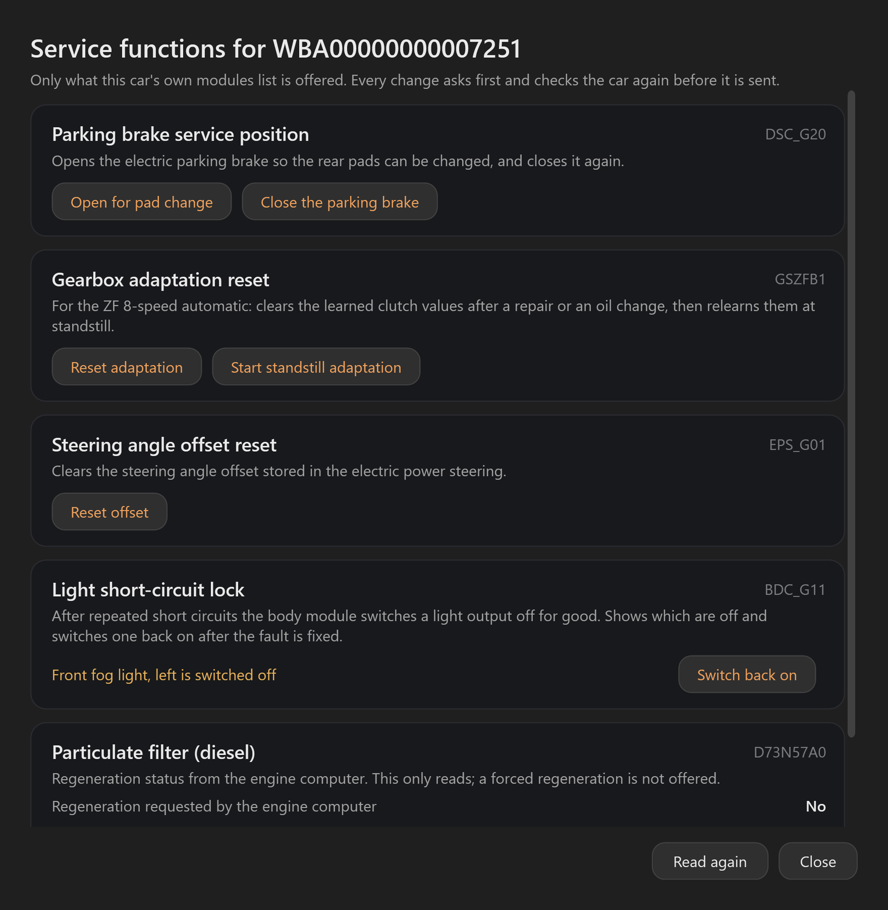

### Car report (PDF)
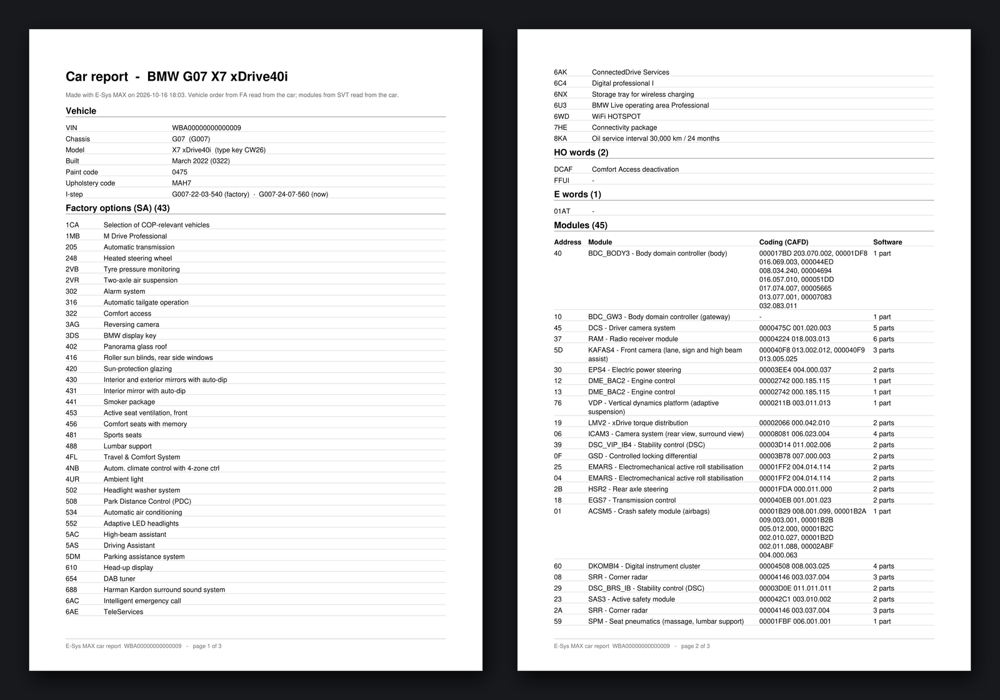

### Module names right in E-Sys
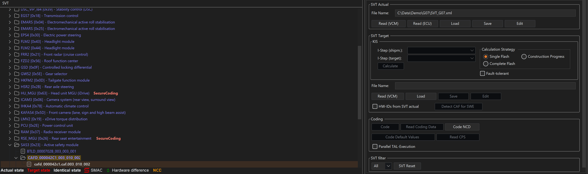

### Badges and levels
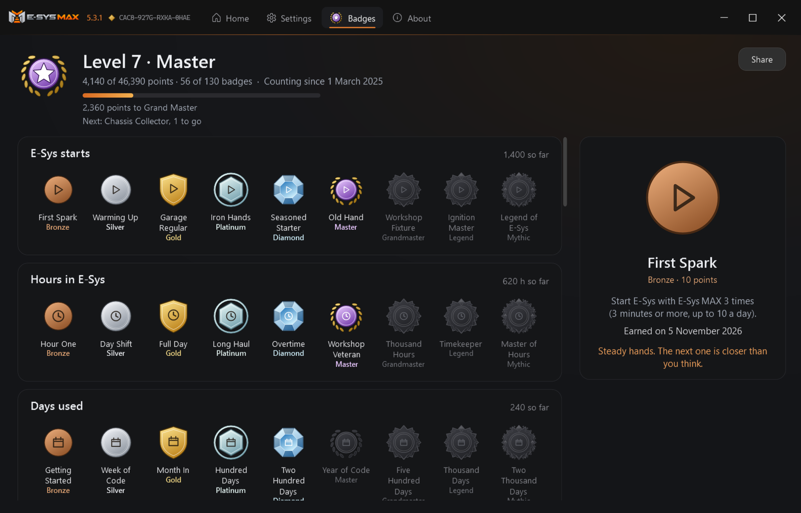

Screenshots use demo cars with made-up VINs.

## Guides and support

- Guides: [BMW E-Sys coding](https://esysmax.com/bmw-e-sys-coding), [E-Sys cheat sheets](https://esysmax.com/e-sys-cheat-sheets),
  [E-Sys launcher](https://esysmax.com/e-sys-launcher), [E-Sys Ultra alternative](https://esysmax.com/e-sys-ultra-alternative),
  [coding by series](https://esysmax.com/bmw-coding-by-series)
- Support and news: [@EsysMaxbot](https://t.me/EsysMaxbot) and [t.me/esysmax](https://t.me/esysmax) on Telegram

---

E-Sys itself and PSdZData are BMW software and are not included. E-Sys MAX is not made by or connected with BMW AG.

This repository holds E-Sys MAX update information and screenshots only. © 2026 KDR Coding. All rights reserved.
