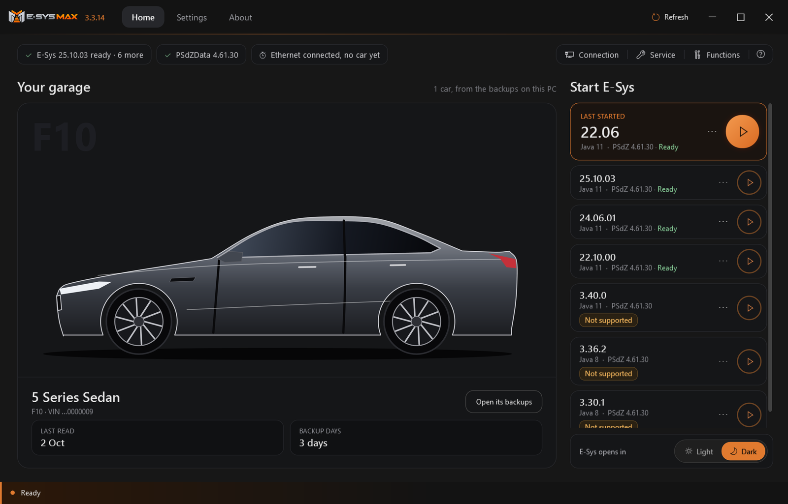
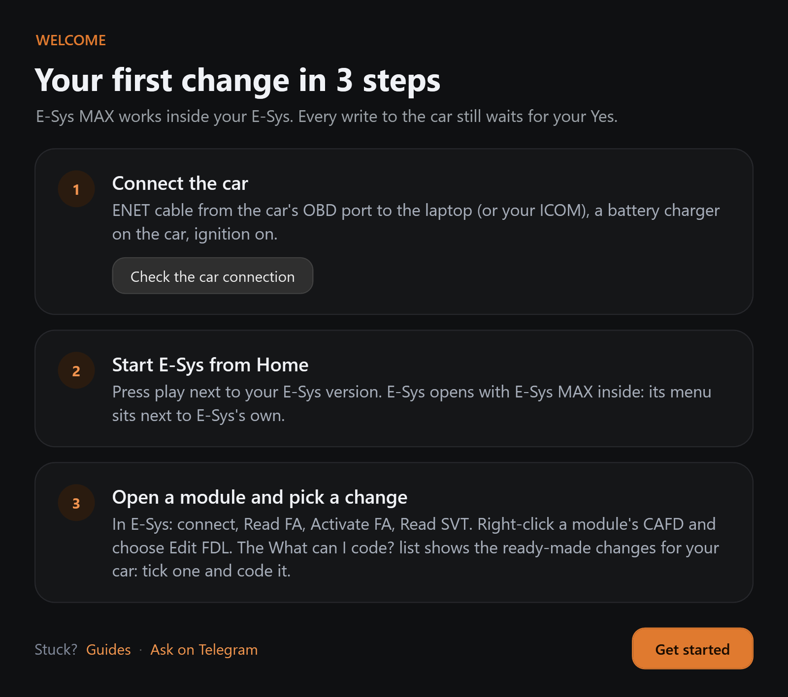
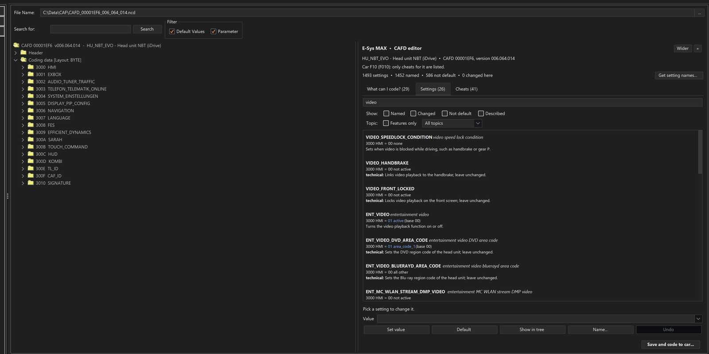
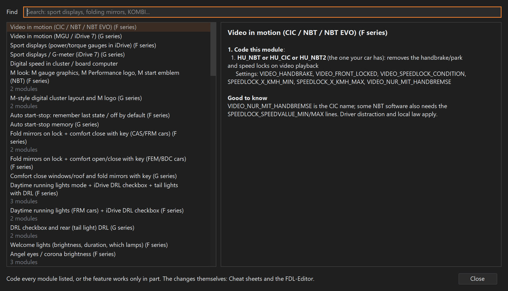
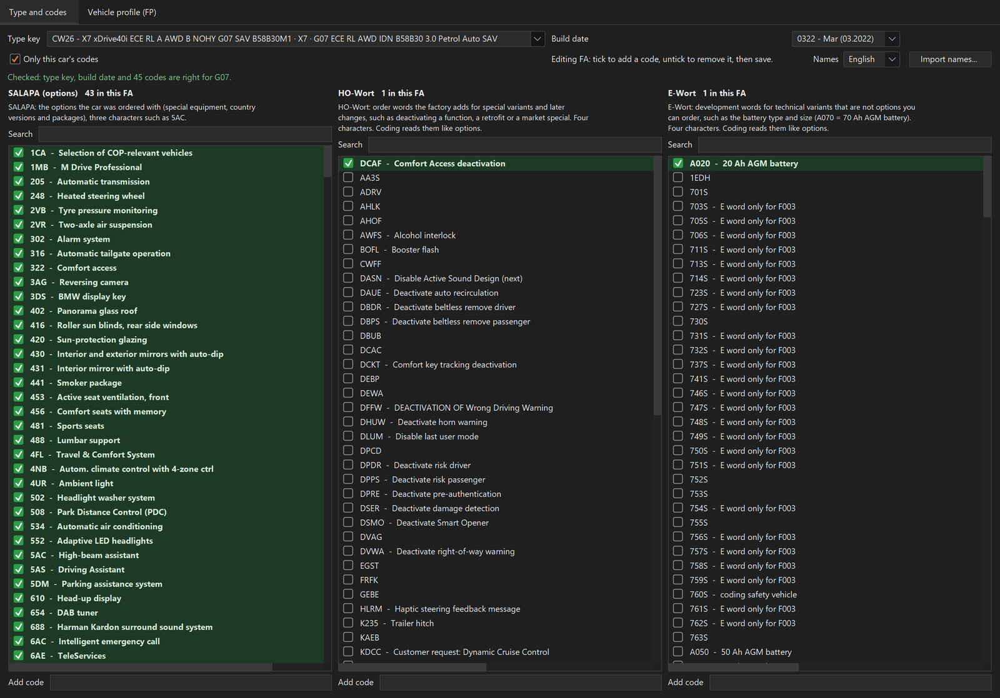
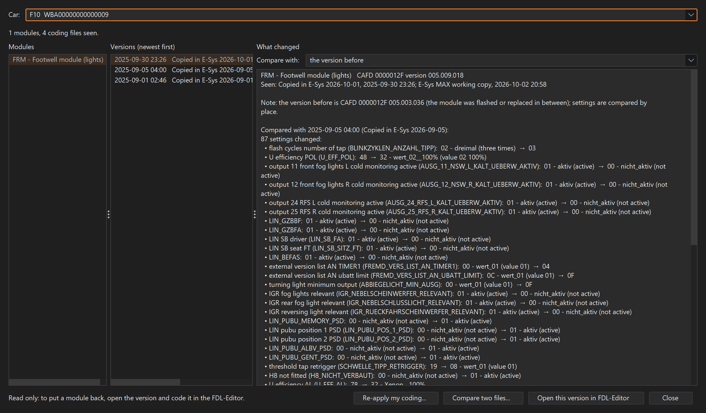
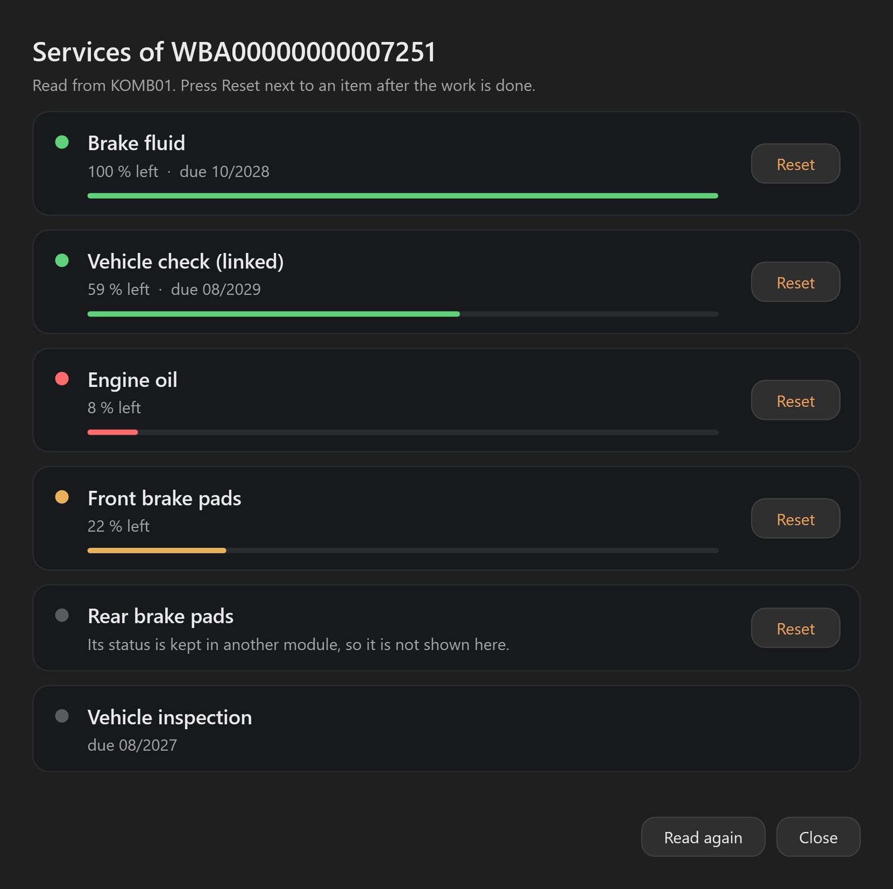
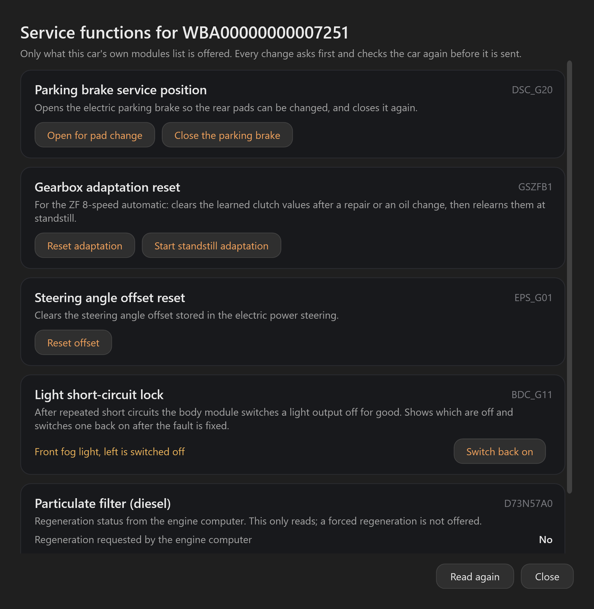
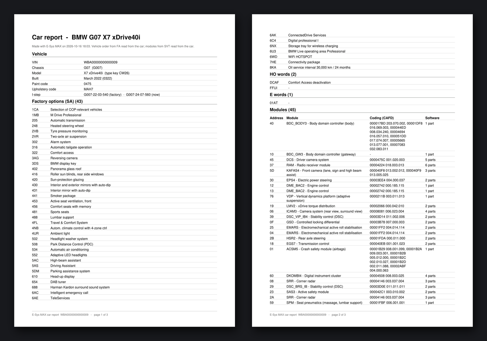
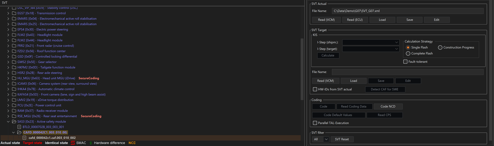

# E-Sys MAX (EsysMax): E-Sys launcher for BMW coding, F series and G series

**E-Sys MAX** is a Windows E-Sys launcher and add-on for coding BMW F series and G series cars with BMW E-Sys
(and MINI and Toyota Supra built on them). An E-Sys Ultra alternative, made by KDR Coding.

> **Like E-Sys MAX?** Tap the ⭐ **Star** button at the top of this page. It takes one second and helps other
> BMW owners find it.

## Download

- **[esysmax.com/download](https://esysmax.com/download)** (Windows 10 and 11), or the installer on this repository's
  [latest release](https://github.com/kdrcoding/esysmax-releases/releases/latest)
- Every update and what it changed: [esysmax.com/changelog](https://esysmax.com/changelog)

## What it does

- **110,000+ E-Sys coding settings named in English**: G series settings that E-Sys shows as a dot get their name
- Starts any E-Sys version with the right Java, memory and PSdZData; works over an ENET cable or a BMW ICOM
- One-click coding changes (cheat sheets) and **what to code for a feature**: every module it needs
- Vehicle order (VO) helper, FDL coding help, full backups and a history of every coding change
- Fault scan with 9,000+ codes explained, **service reset** and service functions
- Car report as a PDF: options, modules and coding of the car

## Screenshots

### Start in 3 steps

### Every setting with a name and a plain explanation

### What to code for a feature

### Vehicle order (VO) helper

### Coding history: see what changed and put it back

### Service reset

### Service functions

### Car report (PDF)

### Module names right in E-Sys

Screenshots use a demo car with a made-up VIN.

## Guides and support

- Guides: [BMW E-Sys coding](https://esysmax.com/bmw-e-sys-coding), [E-Sys cheat sheets](https://esysmax.com/e-sys-cheat-sheets),
  [E-Sys launcher](https://esysmax.com/e-sys-launcher), [E-Sys Ultra alternative](https://esysmax.com/e-sys-ultra-alternative),
  [coding by series](https://esysmax.com/bmw-coding-by-series)
- Support and news: [@EsysMaxbot](https://t.me/EsysMaxbot) and [t.me/esysmax](https://t.me/esysmax) on Telegram

---

E-Sys itself and PSdZData are BMW software and are not included. E-Sys MAX is not made by or connected with BMW AG.

This repository holds the E-Sys MAX installers and screenshots only. © 2026 KDR Coding. All rights reserved.
